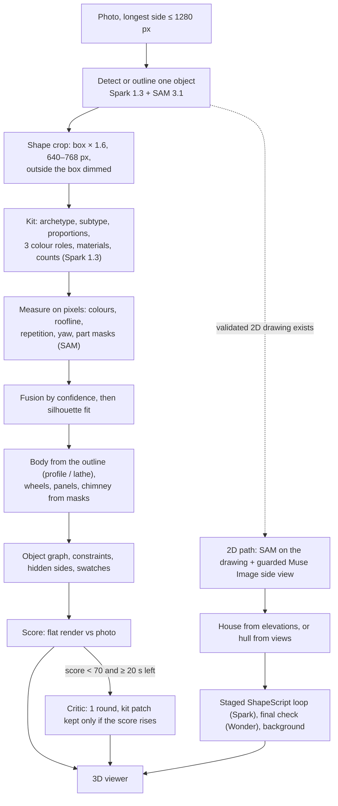

# Vision-to-3D: photo → 3D object with Meta models (methodology)

> **Scope.** How one object on a photo becomes a 3D model on `/village`: what the code does today, where the
> quality is lost, and what to change to get the strongest image-to-3D the Meta models allow.
> **Companions.** Prompt-ready knowledge for each Muse call: `vision-to-3d-muse-skills.md`. Step-by-step
> checklist (tasks, files, tests, gates): `tasks/PV-vision-quality.md`. The sky of `/simulation` (clouds, sun):
> `vision-to-3d-atmosphere.md`.
> **Status words.** « As built » = in the code on 2026-11-10. « Target » = planned in PV-Q, not built.
> Nothing under « Target » is a fact about the app yet.

---

## 1. Audit of the previous version of this file

The previous version (git history, before 2026-11-10) described a cloud layer and a five-agent Meta loop. Checked
against the repository:

| Claim in the old file                                                 | What the repository shows                                                                                                                                                         | Action                                   |
| --------------------------------------------------------------------- | --------------------------------------------------------------------------------------------------------------------------------------------------------------------------------- | ---------------------------------------- |
| The pipeline is clouds: shells, puffs, wrapped diffuse                | True for the `/simulation` sky only. The photo → 3D object pipeline (`server/perception/`, 60+ modules) was not mentioned                                                         | Cloud maths moved to the atmosphere file |
| `node scratch/test-orbit.mjs` verifies the result                     | The script does not exist. Scene audits are `make scene-audit` and `make shape-report`                                                                                            | Replaced by real commands (§8)           |
| Acceptance table « Passed » (1 draw call, 0 bytes / frame, ΔE < 8)    | No run backs it. Scene budget is < 150 draw calls (`performance.md`), not 1                                                                                                       | Removed                                  |
| 13 test files prove each phase                                        | The files exist but test other things: `region-colors` = median colour per SAM mask, `spark-critic` = kit patch round, `autonomous-perf` = dispatch engine timing, not WebGL heap | Test matrix rewritten (§8)               |
| SAM 3.1 takes a role prompt and returns morphology JSON and 3D bounds | SAM is called with an image and a concept word and returns 2D boxes and masks (`client.segmentImage`)                                                                             | Removed                                  |
| Muse Image draws top-down and side views to recover depth             | Spike PR-4.1 (2026-11-02): 2 of 3 generated views were wrong (top-down returned a front view), 9–26.5 s each. Only a guarded side view is used                                    | Rewritten (§5, row 11)                   |
| Muse Wonder orchestrates, Muse Glimmer runs Playwright                | The orchestrator is TypeScript (`runObjectShape`). Wonder does one background final check. Glimmer is the copilot chat fallback (`GLIMMER_BASE_URL`), it runs no tools here       | Rewritten (§2)                           |
| Prices, context sizes, « converges in ≤ 3 iterations »                | Not sourced anywhere in the repository                                                                                                                                            | Removed until measured                   |
| Contract 4 telemetry JSON (ΔE 6.84, IoU 0.892)                        | Sample values, not measurements                                                                                                                                                   | Removed                                  |

Kept from the old file because they are right: analyse the photo before building, build from parametric primitives
instead of one dense mesh, never let a part fall to black, verify with a render compared to the reference, and
correct by targeted parameter changes instead of regenerating.

---

## 2. As built: the pipeline today

One rule shapes everything: **the LLM says what the object is, pixels say how it looks, deterministic code builds
the geometry, a render compared to the photo decides what is kept.** Muse never writes vertices or code.



| Stage           | Model or code               | Files (`apps/web/src/`)                                                         | Numbers that matter                                                           |
| --------------- | --------------------------- | ------------------------------------------------------------------------------- | ----------------------------------------------------------------------------- |
| Photo intake    | `sharp`                     | `server/perception/prepare-image.ts`                                            | Longest side ≤ 1280 px, JPEG quality 85                                       |
| Detect / region | Spark 1.3, SAM 3.1          | `detect.ts`, `region.ts`, `region-prompt.ts`, `outline.ts`                      | One object per shape request                                                  |
| Crop            | `sharp`                     | `shape-crop.ts`                                                                 | Context × 1.6, 640–768 px, outside the box white at 40 %                      |
| Kit             | Spark 1.3                   | `shape.ts` (`SHAPE_SYSTEM_PROMPT`, `SHAPE_JSON_SCHEMA`), `meta.ts` `visionJson` | `reasoning_effort: 'high'`, JSON schema answer, no seed, 150 s call limit     |
| Free parts      | Spark 1.3                   | `free-recipe.ts`                                                                | ≤ 12 plain solids, archetypes without a template                              |
| Measurements    | Pure TypeScript + SAM masks | `color-measure`, `roofline`, `repetition`, `perspective`, `part-masks`          | Part masks: 5 s limit                                                         |
| Fusion and fit  | Pure TypeScript             | `fusion.ts`, `silhouette-fit.ts`, `nelder-mead.ts`, `part-fit.ts`               | Shape maths ≤ 300 ms per object                                               |
| Score           | Pure TypeScript             | `flat-render.ts`, `model-score.ts`, `score-shape.ts`                            | 0.40 silhouette IoU + 0.35 edge F1 + 0.25 colour ΔE                           |
| Critic          | Spark 1.3                   | `spark-critic.ts`, `shape.ts` (`CRITIC_SYSTEM_PROMPT`)                          | 256 px sheet, only under 70 / 100, 1 round                                    |
| 2D path         | SAM 3.1, Muse Image 1.0     | `facade-*.ts`, `object-views.ts`, `views-check.ts`                              | Side view kept only when it differs from the front and its depth is plausible |
| Staged loop     | Spark 1.3, then Wonder 1.0  | `lib/shape-script.ts`, `shape-stages*.ts`, `shape-script-prompt.ts`             | ≤ 3 rounds per stage, ≤ 12 ops, each op tried alone, kept only on gain        |
| Viewer          | React Three Fiber           | `features/vision-insert/utils/object-geometry.ts`, `surface-look.ts`            | ≤ 5 000 triangles, 12 parts (photo) or 32 components (2D path)                |

Vocabulary the geometry engine can build: `box, cylinder, sphere, cone, prism, extrude, lathe, hip, hull`, 15
materials, 17 archetypes (`lib/object-kit.ts`, `lib/object-shape.ts`).

**Last measured state** (`make shape-report`, 2026-11-04): mean score 93 on five objects, IoU 0.98, edge F1 0.91,
ΔE 3.4, every stop criterion met. Kit eval on four real captures: Spark 1.3 agrees with the frozen kits on 23 of
26 fields, 13.8 s median.

---

## 3. The main finding: the judge passes models that do not look right

The report says 93 / 100 and « every object meets the criteria ». The contact sheet of the same report shows a car
that is a red slab with a grey wedge and two dark ellipses, a fridge without a handle, and a lamp head drawn as a
squat drum. Both are true at once, for three reasons:

1. **The five reference pictures are synthetic.** They are flat-colour drawings (a red rectangle with two black
   rectangles is « the car »). A model that reproduces a flat drawing scores high and says nothing about a real
   photo. The real set planned as PR-0.5 (10 user photos) was never captured; four real captures exist (fan, lamp,
   fridge, TV).
2. **The score cannot see detail.** Silhouette, outline edges and mean colour make up 100 % of it. A brick with the
   right outline and paint scores above 90. Handles, door lines, mirrors, window frames and wheel rims are worth
   nothing.
3. **The critic almost never runs, and sees little when it does.** It fires only under 70 / 100, on a 256 px wide
   sheet, comparing the photo to a flat render with sharp boxes, while the viewer shows bevelled, textured parts.

So every later improvement was judged by a ruler that stops measuring at « right outline, right colour ». Fixing
the ruler comes first (§5 rows 1–3): without it, prompt and geometry work cannot be told apart from noise.

---

## 4. Method (the generalised recipe)

For any photo → 3D task in this project, in this order:

1. **Qualify the photo before asking a model.** Measure size in pixels, blur, exposure, hidden share and view
   angle. Tell the model what was measured, and lower the trust in what cannot be measured.
2. **Give the model the best pixels.** A context image to recognise the object, a tight image to read its parts.
3. **Make the model look before it answers.** It first lists what it sees (parts, where, hidden by what), then
   commits to the kit. Its answer is a small, strict JSON, never geometry.
4. **Give the model what a specialist would know.** One skill card per object family: the parts that family
   always has, the proportions it usually has, the mistakes this pipeline makes on it.
5. **Measure everything that can be measured.** Outline, colours, roof line, repetition, yaw, part positions.
   A measurement replaces a guess in proportion to its confidence.
6. **Build with parametric parts,** grouped as an object graph (window in wall, wheel on body), so every later
   correction is a parameter change.
7. **Judge on real photos with a score that sees detail,** then let a second Meta model grade what numbers miss.
8. **Correct in small steps, keep only gains.** One op at a time, re-render, re-score, drop what does not help.
9. **Say what is measured and what is imagined.** Every part carries its status; hidden sides are inferred, and
   shown as such.
10. **Never** paste the photo on the model, call a non-Meta AI, or let any model output an energy value.

---

## 5. What to refine, ranked by effect on the result

Each row names the evidence in the code and the task that fixes it (`tasks/PV-vision-quality.md`).

| #   | Weak point                                   | Evidence                                                                                                     | Target                                                                                                                    | Task          |
| --- | -------------------------------------------- | ------------------------------------------------------------------------------------------------------------ | ------------------------------------------------------------------------------------------------------------------------- | ------------- |
| 1   | Reference set is synthetic                   | `__fixtures__/shape/index.ts` goldens are drawn; PR-0.5 unchecked                                            | ≥ 12 real captured photos, hard cases included; the report gets a « Real » table that drives the loop                     | PQ-T1         |
| 2   | Score blind to detail                        | `SCORE_WEIGHTS = { iou: 0.4, edge: 0.35, color: 0.25 }`                                                      | Detail score: part recall, part precision, interior edge F1, colour per part                                              | PQ-T2, PQ-T6  |
| 3   | Judge and viewer show different models       | Flat render draws plain components; assemblies and bevels exist only in the viewer                           | Flat render draws assembly details; a Wonder rubric grades photo vs ¾ render                                              | PQ-T3, PQ-T4  |
| 4   | Kit prompt hurries the model                 | « Answer fast and short »; schema has no place for what was seen                                             | Observe-then-commit schema: evidence list first, kit second, a confidence per field group                                 | PQ-T12        |
| 5   | No specialist knowledge per object family    | One prompt for 17 archetypes; only vehicles have an anatomy line                                             | Skill cards per archetype, loaded by the detection hint                                                                   | PQ-T11, T13   |
| 6   | Critic is weak                               | `CRITIC_WIDTH = 256`, `CRITIC_SCORE_MAX = 70`, 1 round, photo vs flat front only                             | 2 × 2 sheet at ≥ 512 px per tile with a difference tile and a ¾ view; fires on the detail score                           | PQ-T14        |
| 7   | Photo path has no step-by-step loop          | `facadeStageLoop` and `viewStageLoop` run only with a validated 2D drawing                                   | The same staged loop with the photo crop and its SAM masks as target, in the background                                   | PQ-T19        |
| 8   | One missed outline ruins everything          | Toy-Mini investigation: SAM answers change with the pixels; no outline → no fit, no body, no measured colour | Several SAM phrasings on photo and crop, agreement decides; time limits follow the remaining budget                       | PQ-T9         |
| 9   | Hidden objects are guessed blind             | Prompt asks to « imagine »; nothing measures how much is hidden                                              | Hidden share measured and told to the model; operator may ask for a clean front drawing, then the 2D path                 | PQ-T7, PQ-T23 |
| 10  | Details have no geometry                     | 12 parts on the photo path; no handle, seam, mirror, gutter, rim                                             | Detail assemblies expanded in the viewer and drawn in the flat render; 32 components when masks are measured              | PQ-T20, T21   |
| 11  | Generated views are unreliable               | PR-4.1: 2 of 3 wrong; side prompt is one sentence                                                            | View card, two candidates, the most consistent one kept (height, top line, colours); back view by mirror, never generated | PQ-T16, T24   |
| 12  | Surfaces look uniform                        | One `SURFACE_LOOK` entry per material; one colour per role; no shadow where parts meet                       | Colours per region, gloss measured on the photo, baked ambient shadow at part joints                                      | PQ-T25–T28    |
| 13  | Prompts cannot be compared                   | Only `SHAPE_SCRIPT_PROMPT_VERSION` and `FREE_PARTS_PROMPT_VERSION` exist                                     | A version on every prompt, logged and stored in captures; eval table per version                                          | PQ-T5         |
| 14  | Same reasoning effort and one sample for all | `reasoning_effort: 'high'` on every vision call; one answer trusted                                          | Effort per call measured against accept rate and latency; two kit samples vote when time allows                           | PQ-T17, T18   |
| 15  | Colours include shadow                       | PG-T22 note: walls read tan because plaster, timber and shadow were averaged                                 | Colour read on the lit share of each region; shadow reported apart                                                        | PQ-T10        |

---

## 6. Target design of the parts that need a definition

### 6.1 Detail score (PQ-T2)

Computed by pure code from what is already available: SAM part masks on the photo and the recipe rendered flat at
the photo's view.

- **Part recall** = SAM parts with a matching model part of the same kind ÷ SAM parts. A match: centre distance
  ≤ 0.10 of the box diagonal and area ratio between 0.5 and 2.
- **Part precision** = model parts of a visible kind with a matching SAM part ÷ such model parts. Parts marked
  `inferred` on hidden sides are not counted.
- **Interior edge F1** = the existing edge F1, restricted to pixels inside the outline shrunk by twice the edge
  tolerance. It rewards door lines, window frames and seams, which outline edges never see.
- **Colour per part** = mean ΔE between each matched part's region on the photo and on the render.

Reported as its own columns first. It enters the weighted score only after the baseline on the real set is known
(PQ-T6), so a threshold is never chosen to pass one case.

### 6.2 Rubric judge (PQ-T4)

Muse Wonder receives one sheet (photo, model front, model ¾) and grades six criteria from 1 to 5: silhouette,
proportions, parts present, parts placed, colours and materials, overall likeness. It returns JSON with one
sentence per criterion below 4. It is used offline and in the background, never in the first answer.

It is trusted only after calibration: on every real capture, remove two parts from the recipe and render again.
The judge must grade the damaged model lower in at least 90 % of the pairs. Below that, the judge stays out of the
loop and only its text is shown to the developer.

### 6.3 Observe-then-commit kit (PQ-T12)

The schema gains an `evidence` object placed **before** the kit fields, so the model writes what it sees before
it classifies:

```ts
evidence: {
  view: 'front' | 'side' | 'three_quarter' | 'back' | 'top';
  visibleParts: { name: string; where: string }[]; // ≤ 12, plain words: "wheel, lower left"
  hiddenBy: string[]; // "hedge", "person", "image edge"
  unsure: string[]; // fields it had to guess
}
```

`evidence` is used three ways: it becomes SAM concept words for part masks, `unsure` lowers the fusion confidence
of the named fields, and it is logged so a wrong kit can be traced to a wrong observation. The line « Answer fast
and short » is removed. Geometry numbers stay forbidden.

### 6.4 Photo-path staged loop (PQ-T19)

Same runner as the 2D path (`runShapeStages`), new target:

- Target image = the tight crop; target parts = SAM masks on the photo; view = measured yaw.
- Stage score = silhouette IoU at that view plus the detail score of the stage's part kinds.
- Stages per archetype from `view-stages.ts` (vehicle: body → glass → wheels → details).
- Runs in the background after the first answer, with the existing chip, checkpoints and « keep only gains » rule.
- Parts the photo cannot see are locked, as side walls are locked on a front elevation.

### 6.5 SAM agreement (PQ-T9)

For the outline: ask up to three phrasings (the label, its normalised noun, the archetype noun) on the photo and
on the crop. Keep a mask when two answers overlap with IoU ≥ 0.8; otherwise keep the most confident mask that
lies inside the box by ≥ 90 %; otherwise report « no outline » with the cause. Calls run in parallel and stop
when two agree.

---

## 7. Files to add, modify or rewrite

Paths under `apps/web/src/` unless they start with `docs/`, `.claude/` or a root file. Every new module ships with
its Vitest test in `__tests__/` in the same commit.

**Add**

| File                                                                      | Purpose                                                               | Task       |
| ------------------------------------------------------------------------- | --------------------------------------------------------------------- | ---------- |
| `server/perception/__fixtures__/shape/real/*.capture.json` + `*.crop.jpg` | Real reference set (≥ 12)                                             | PQ-T1      |
| `server/perception/detail-score.ts`                                       | Part recall / precision, interior edge F1, colour per part            | PQ-T2      |
| `server/perception/rubric-judge.ts`                                       | Judge sheet, question, schema, parser, calibration helper             | PQ-T4      |
| `server/perception/photo-conditions.ts`                                   | Blur, exposure, pixel size, hidden share, view class                  | PQ-T7      |
| `server/perception/sam-consensus.ts`                                      | Several phrasings, agreement rule, miss cause                         | PQ-T9      |
| `server/perception/skills/index.ts`                                       | `skillFor(call, archetype)`, versions, size cap                       | PQ-T11     |
| `server/perception/skills/{base,archetypes,critic,stages,views,judge}.ts` | The cards of `vision-to-3d-muse-skills.md` as versioned string arrays | PQ-T11–T16 |
| `server/perception/photo-stages.ts`                                       | Target and scorer of the photo-path staged loop                       | PQ-T19     |
| `server/perception/view-candidates.ts`                                    | Consistency score between a generated view and the front              | PQ-T16     |
| `server/perception/gloss-measure.ts`                                      | Gloss estimate per region from highlight statistics                   | PQ-T26     |
| `features/vision-insert/utils/vertex-ao.ts`                               | Baked ambient shadow at part joints                                   | PQ-T27     |
| `scripts/shape-judge.mjs` + Makefile target `shape-judge`                 | Run the rubric judge on the real set, on demand                       | PQ-T4      |

**Modify**

| File                                                                            | Change                                                                                      | Task                |
| ------------------------------------------------------------------------------- | ------------------------------------------------------------------------------------------- | ------------------- |
| `server/perception/__fixtures__/shape/index.ts`                                 | Register the real set, tag each case synthetic or real                                      | PQ-T1               |
| `server/perception/model-score.ts`, `score-shape.ts`                            | `detail` on `ModelScore`; later the detail weights                                          | PQ-T2, PQ-T6        |
| `server/perception/shape-report.ts`                                             | « Real » table, detail and judge columns, new stop criteria                                 | PQ-T1, T2, T6       |
| `server/perception/flat-render.ts`                                              | Draw assembly details (frames, panes, handles, rims) so the judge sees them                 | PQ-T3               |
| `server/perception/shape.ts`                                                    | Kit prompt and schema (evidence, confidences, wider details), versions, critic schema       | PQ-T5, T12, T14     |
| `server/perception/free-recipe.ts`                                              | Skill card and evidence for free parts                                                      | PQ-T12              |
| `server/perception/spark-critic.ts`                                             | 2 × 2 sheet, ≥ 512 px tiles, difference tile, gate on the detail score, 2 background rounds | PQ-T14              |
| `server/perception/views-check.ts`, `shape-script-prompt.ts`                    | Skill cards, versions                                                                       | PQ-T5, PQ-T15       |
| `server/perception/object-views.ts`, `facade-views.ts`                          | View card, two candidates, consistency pick                                                 | PQ-T16              |
| `server/perception/meta.ts`, `client.ts`, `mock.ts`, `backend.ts`               | Reasoning effort per call, second image, kit samples, `judgeShape`                          | PQ-T4, T8, T17, T18 |
| `server/perception/shape-crop.ts`                                               | Tight object image next to the context crop                                                 | PQ-T8               |
| `server/perception/outline.ts`, `part-masks.ts`                                 | Use `sam-consensus`; time limits from the remaining budget                                  | PQ-T9               |
| `server/perception/color-measure.ts`, `region-colors.ts`                        | Lit-share colour, shadow apart                                                              | PQ-T10              |
| `server/perception/fusion.ts`                                                   | Confidences from photo conditions and from `evidence.unsure`                                | PQ-T7, PQ-T12       |
| `server/perception/object-shape.ts`                                             | Wire conditions, consensus, photo stages, samples; new log lines                            | PQ-T7–T19           |
| `server/perception/shape-stages-spark.ts`, `view-stages.ts`                     | `photoStageLoop`, stage kinds for detail parts                                              | PQ-T19, PQ-T20      |
| `server/perception/hidden-sides.ts`                                             | Mirror measured sides to hidden ones, status `inferred`                                     | PQ-T22              |
| `lib/object-kit.ts`, `lib/object-shape.ts`, `lib/shape-script.ts`               | Detail kinds, evidence schema, component budget on the photo path                           | PQ-T12, T20, T21    |
| `features/vision-insert/utils/view-assemblies.ts`, `object-geometry.ts`         | Detail assemblies, ambient shadow                                                           | PQ-T20, PQ-T27      |
| `features/vision-insert/utils/surface-look.ts`                                  | Roughness and clearcoat shifted by measured gloss, within ± 0.2                             | PQ-T26              |
| `features/vision-insert/ui/object-shape-panel.tsx` + `messages/{en,fr,mg}.json` | Photo-quality hint, « draw a clean front » action, judge note                               | PQ-T7, PQ-T23       |
| `lib/env.ts`, `.env.example`                                                    | `SHAPE_KIT_SAMPLES`, `META_JUDGE_MODEL`                                                     | PQ-T4, PQ-T18       |
| `Makefile`                                                                      | `shape-judge`; `eval-shape` takes `PROMPT=`                                                 | PQ-T4, PQ-T5        |

**Rewrite or update (docs and agent files)**

| File                                                      | Change                                                             | Task   |
| --------------------------------------------------------- | ------------------------------------------------------------------ | ------ |
| `docs/vision-to-3d-methodology.md`                        | This rewrite; move « Target » items to « As built » as they land   | PQ-T30 |
| `docs/vision-to-3d-muse-skills.md`                        | Source of the cards; kept equal to `server/perception/skills/`     | PQ-T11 |
| `docs/contracts.md`                                       | Evidence, detail score, judge result, detail kinds, new SSE fields | PQ-T30 |
| `docs/copilot.md`                                         | Prompt versions, effort table, judge model, skill loader           | PQ-T30 |
| `docs/performance.md`                                     | Time budget per call, background rounds                            | PQ-T30 |
| `docs/tasks/PV-shape-realism.md`                          | Loop log rows; PR-0.5 closed by PQ-T1                              | PQ-T29 |
| `docs/tasks/PV-any-object.md`                             | PH-T8, PH-T9 closed by PQ-T25, PQ-T24                              | PQ-T30 |
| `.claude/skills/shape-3d/SKILL.md`, `shape-loop/SKILL.md` | Real set first, detail score, judge, skill cards                   | PQ-T30 |
| `README.md`, `test-scenarios/06-village.md`               | Features, limits, one scenario per visible change                  | PQ-T30 |

---

## 8. Verification: commands that exist

| Question                                       | Command                                                    | Passes when                                                |
| ---------------------------------------------- | ---------------------------------------------------------- | ---------------------------------------------------------- |
| Does the shape pipeline still work offline?    | `make test-shape`                                          | Golden set green                                           |
| How good is every object, and which is worst?  | `make shape-report` → `test-results/shape-report/index.md` | Stop criteria met on the real table (§9)                   |
| What does the user really see?                 | `make shape-shots` (dev server running)                    | Viewer shots, dark and light, reviewed with `/designer-3d` |
| Did a prompt change help the kit?              | `make eval-shape MODEL=…` (live, costs API calls)          | Agreement not lower, median ≤ 30 s                         |
| Did a prompt change help the staged loop?      | `make eval-stages` (offline replay)                        | Stage scores not lower                                     |
| Does the 2D path work end to end on live Meta? | `make facade-e2e FRONT=… OUT=…` (costs API calls)          | Model built, stages logged                                 |
| Add a real photo to the reference set          | `make shape-capture PHOTO=… ID=…` (costs API calls)        | Capture and crop written to `__fixtures__/shape/real/`     |
| Everything before handoff                      | `make check`                                               | Typecheck, lint, tests green                               |

---

## 9. Stop criteria (target, on the real set)

A model is good enough when, per object:

- Silhouette IoU ≥ 0.85, outline edge F1 ≥ 0.6, colour ΔE ≤ 8 (as today).
- Part recall ≥ 0.8 and part precision ≥ 0.8; interior edge F1 and colour per part above the gates fixed in PQ-T6
  from the measured baseline.
- No graph constraint violated; every hidden part marked `inferred`.
- Judge ≥ 4 / 5 on average with no criterion under 3 (only once the judge passed its calibration).
- `/designer-3d` ≥ 4 / 5 on the viewer shots, dark and light.
- ≤ 5 000 triangles, shape maths ≤ 300 ms, first answer ≤ 60 s; later rounds in the background.

The pass is over when every real object meets them, or after three rounds on the same object without gain, which
is reported with the sheet and the blocking cause (`/shape-loop`).

---

## 10. Limits that stay

- No Meta model on the API turns a photo into a mesh (checked 2026-11-01, `copilot.md`): templates, measurements
  and the loop remain the only route.
- Sides the photo does not show are inferred by symmetry and rules. They are plausible, never measured.
- Generated views are drawings by a model. They are used only after consistency checks and can still be wrong.
- Photo swatches are small tileable patches (≈ 64 px). The photo is never projected on the model.
