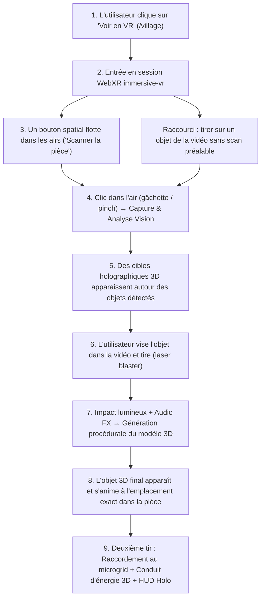

# Immersion WebXR sur /village : Détection Spatiale dans les Airs & Tir/Génération 3D

> **Statut :** En production / Implémenté & Validé  
> **Cible :** Route `/village` (Village Studio / Vision Insert)  
> **Technologies :** WebXR, Three.js, React Three Fiber (R3F), Meta IWER 2.8.0 (Émulateur Quest 3), Web Audio API, `@mitsinjo/engine`  
> **Environnement de test :** Émulateur desktop (100 % sans casque via Play Mode) et casque physique Meta Quest (Quest 3 / 3S / Pro)

---

## 1. Résumé exécutif

| Question                                    | Statut           | Détails                                                                                                                                                                                                                   |
| ------------------------------------------- | ---------------- | ------------------------------------------------------------------------------------------------------------------------------------------------------------------------------------------------------------------------- |
| **Est-ce techniquement possible ?**         | **OUI (Validé)** | L'ensemble du cycle (bouton 3D dans l'espace, capture, détection IA, raycast de tir laser, apparition procédurale 3D, raccordement au microgrid) s'appuie sur des technologies WebXR standardisées et fonctionne in-situ. |
| **Faisable avec l'émulateur seulement ?**   | **OUI à 100 %**  | Grâce au preset Meta Quest 3 de **Meta IWER 2.8.0** intégré dans le projet (`dev-xr-emulator.ts`), le déplacement, la visée laser et la gâchette se testent au clavier/souris sans casque physique.                       |
| **Mode hors-ligne / développement**         | **Garanti**      | Compatible avec `make dev-mock` : les détections et shapes 3D s'exécutent en local sans clé API externe requise.                                                                                                          |
| **Synchronisation simulation micro-réseau** | **Active**       | Les tirs en VR sur les appareils générés injectent/retirent dynamiquement les charges dans le moteur de calcul `@mitsinjo/engine` avec animation de conduit d'énergie 3D (`PowerConnectionBeam`).                         |

---

## 2. Parcours utilisateur & Cycle d'interaction



---

## 3. Décomposition technique des phases & Checklists

### Phase 1 : Bouton spatial "dans les airs" (Diegetic Spatial UI)

- **Défi WebXR :** Les balises HTML standards du DOM (`<button>`, `<div>`, `<Html>` de Drei) ne sont pas projetées en stéréo dans le casque VR.
- **Architecture :**
  - Un composant 3D Three.js pur (`<SpatialAirButton />`) suspendu dans le champ de vision (coordonnées relatives tête : `[0, 1.45, -1.2]` m).
  - Plaque holographique translucide en verre sombre, bordure cyan brillante (`TOKEN_HEX.energyCyan`), pulsation lumineuse d'attente.
  - Interaction : survol par le pointeur laser du contrôleur XR, puis appui sur la gâchette (`selectstart`).
  - Synthétiseur audio Web Audio API pour le bip radar lors du scan.

#### Checklist Phase 1 :

- [x] Conteneur WebXR dédié (`VillageXRViewport`) avec cycle de vie `useWebXR`.
- [x] Détection et émulateur automatique Meta IWER 2.8.0 preset Quest 3.
- [x] Composant 3D `<SpatialAirButton />` flottant à hauteur d'yeux avec canvas texture 2D haute résolution.
- [x] États visuels : `idle`, `scanning` (radar rotatif), `completed`.
- [x] Effet audio procédural de chirp radar sans fichier externe (`xr-audio-fx.ts`).
- [x] Raycast interactif gâchette / souris (`selectstart`) sur le bouton spatial.

---

### Phase 2 : Détection en temps réel sans upload classique (Spatial Vision Pipeline)

- **Mécanismes de capture :**
  1. **En direct / Émulateur :** Capture vidéo live via `navigator.mediaDevices.getUserMedia({ video: true })` avec bascule automatique sur image d'échantillon `/samples/vision-room.jpg`.
  2. **Sur casque réel (Meta Quest Browser) :** Capture de l'environnement virtuel ou webcam USB/caméra autorisée.
- **Traitement & Réticules spatiaux :**
  - L'image capturée est envoyée à `POST /api/vision` (ou mockperception en `dev-mock`).
  - `spatial-projection.ts` projette chaque boîte 2D sur **l'écran webcam incurvé, à l'endroit où l'objet apparaît dans la vidéo** (géométrie partagée `webcam-screen.ts`) : le cadre holographique se pose sur l'objet vu depuis l'œil (25 cm devant l'écran), et le modèle 3D sort de l'image sur la même ligne de visée à 1,6 m de l'œil (côté max 0,9 m).
  - Cibles `<HoloDetectionTarget />` : cadre filaire cyan animé, étiquette textuelle billboard 3D (ex: _"Réfrigérateur · 180W"_), collider invisible.

#### Checklist Phase 2 :

- [x] Méthode `captureLiveOrSample()` combinant webcam locale et fallback `/samples/vision-room.jpg`.
- [x] Hook ou session de détection connectée à l'API de vision perception.
- [x] Algorithme de projection spatiale 2D $\rightarrow$ 3D (`spatial-projection.ts`) alignée sur l'objet dans la vidéo (`webcam-screen.ts`).
- [x] Composant `<HoloDetectionTarget />` avec double boîte filaire cyan, texture canvas billboard et gestion du hover.
- [x] Tests unitaires pour `spatial-projection.ts` et `<HoloDetectionTarget />`.

---

### Phase 3 : Visée & Tir sur l'objet ("Laser Blaster")

- **Mécanique de visée et visualisation corporelle :**
  - Contrôleur WebXR actif (`renderer.xr.getController(0)`) avec rayon laser continu visible en temps réel.
  - Modèle 3D de manette **Meta Quest Touch Controller** complet (manche, tête, anneau de suivi et gâchette index).
  - Modèle 3D de main **Hand Tracking 25 articulations** (poignet, paume, phalanges index, majeur, annulaire, auriculaire et pouce) s'adaptant dynamiquement au mode mains nues.
  - Réticule d'impact (pip dot) projeté à la distance exacte d'intersection avec les cibles.
  - Raycaster Three.js en boucle `useFrame` testant les intersections cibles.
  - Unprojection souris desktop intégrée (`_raycaster.setFromCamera`) pour viser et cliquer directement sur les boutons 3D sans casque.
- **Menu au poignet (VS-T13) :** à l'entrée, aucun panneau flottant. Un petit bouton (Ø 4,4 cm, étiquette « Menu » / « Fermer »)
  est porté sur le poignet gauche (joint `wrist` en suivi des mains, poignée gauche avec manettes ; sans entrée gauche
  suivie, en bas à gauche de la vue). Le doigt de l'autre main, le laser, le pincement ou la souris l'ouvre / le ferme.
  Le menu (bouton de scan, guide, HUD) apparaît à 0,9 m devant, 32 cm sous les yeux, dans le monde (règle Meta : menu
  lancé _depuis_ le poignet, jamais accroché au poignet ; ≥ 0,8 m pour le rayon) et **suit la personne en différé**
  (`wrist-menu.ts`, `updateLazyFollow`) : il reste immobile, puis se recentre en douceur si l'on tourne la tête
  de plus de ~35° ou si l'on s'éloigne de plus de 35 cm. Fermé, le bouton pulse en orange à chaque nouvel événement.
- **Source d'entrée unique :** `XRBlasterController` gère manettes, mains, doigt et souris. Les composants (bouton, cibles, HUD) n'ont plus de `onClick` R3F propre (un clic tirait deux fois).
- **Visée sur la vidéo :** le rayon coupe l'écran webcam → point image $(u, v)$ → la plus petite boîte de détection qui le contient (une prise sur une table gagne sur la table). Hors de toute boîte : avant tout scan, le tir lance le scan puis transforme en 3D l'objet sous ce point ; après un scan, notification « Aucun objet détecté à cet endroit ».
- **Action de tir :**
  - Un tir par appui : `selectstart` seulement (gâchette, ou pincement natif des mains). Le rayon des mains est celui du système (`getController(i)`), pas un rayon poignet → index ; plus de détection de pincement maison (elle doublait le tir).
  - Flash blanc, onde de choc circulaire cyan, retour haptique `hapticActuators.pulse()` sur la manette qui a tiré.
  - Sons synthétisés procéduraux pour le tir et l'impact (`playLaserShootSound()`, `playTargetHitSound()`).

#### Checklist Phase 3 :

- [x] Contrôleur `<XRBlasterController />` avec rayon laser continu et reticule d'impact dynamique.
- [x] Modèle 3D complet de manette Touch (`createControllerGripModel()`) et main articulée 25 articulations (`createHandMesh()`).
- [x] Support unprojecté direct à la souris pour navigation desktop sur écran plat.
- [x] Détection des intersections temps réel via `THREE.Raycaster`.
- [x] Effets de tir : décharge de projectile, onde de choc sphérique et flash lumineux.
- [x] Effets sonores procéduraux Web Audio API (`playLaserShootSound`, `playTargetHitSound`).
- [x] Impulsion haptique sur contrôleur XR physique (`gamepad.hapticActuators`).
- [x] Tests unitaires pour le contrôleur blaster et les effets audio.

---

### Phase 4 : Génération et apparition du modèle 3D in-situ (Spawn & Morphing)

- **Appel de génération :**
  - Génération de géométrie procédurale via `recipeMesh` / `silhouetteMesh` (`object-geometry.ts`) à l'échelle de la scène.
- **Miniature 3D à portée de main (VS-T12) :**
  - Le modèle sort de l'objet dans la vidéo et vole en 0,7 s jusqu'à un socle devant l'utilisateur
    (`miniatureSlot` dans `xr-layout.ts` : ~0,55 m, sous les yeux, à droite puis à gauche, 6 par rangée).
  - Miniature de 22 cm (plus grand côté, proportions gardées), anneau de socle cyan / vert si raccordée.
  - Elle tourne seule (`turntable.ts`, ~12 s par tour) ; pas d'ombre de contact (cible de rendu en plus = FFR/MSAA cassés).
- **Manipulation (spécs « grab » Meta : objet laissé en place, cinématique, un seul geste « select ») :**
  - Gâchette, pincement ou clic **maintenu** sur la miniature → prise ; tourner / déplacer la manette ou la main
    (ou glisser la souris) la fait tourner (lacet + inclinaison ≤ 60°) ; relâcher → elle reprend sa rotation après 1,5 s.
  - **Tap** (relâché sans rotation, < 0,15 rad, en moins de 1,2 s) → raccorde / déconnecte l'appareil.
  - Un pincement la main posée sur la miniature (origine du rayon dedans) la saisit aussi.

#### Checklist Phase 4 :

- [x] Composant `<SpawnedObject3D />` liant les recettes d'archetypes (`ObjectRecipe`).
- [x] Séquence temporelle élastique de matérialisation in-situ.
- [x] Anneau d'aura émissif au socle (plus d'ombres de contact en XR).
- [x] Miniature tournante à portée de main, saisie et rotation manette / main / souris, tap = raccorder.
- [x] Maintien de l'ancrage spatial et interaction continue avec le blaster.
- [x] Tests de rendu et de mise à l'échelle pour objets multiples.

---

### Phase 5 : Raccordement au Réseau dans les Airs (In-Air Grid Connect & Power Beams)

- **Interaction de raccordement en VR :**
  - Tirer sur un objet 3D déjà matérialisé bascule son état de raccordement électrique sans quitter la VR.
  - Étiquette holographique dynamique : _« ⚡ Visez et tirez pour raccorder (+180 W) »_ / _« ⚡ Visez et tirez pour déconnecter »_.
- **Conduit d'énergie 3D & Jumeau numérique :**
  - Conduit d'énergie en tube Catmull-Rom (`<PowerConnectionBeam />`) avec impulse lumineuse le long du câble vers le centre du village.
  - Synchronisation en direct avec le moteur `@mitsinjo/engine` (`useSimulationAppliances().upsert()`) et `usePlacedModelsStore`.
  - Sons procéduraux de connexion / déconnexion au réseau (`playGridConnectSound()`, `playGridDisconnectSound()`).

#### Checklist Phase 5 :

- [x] Bascule d'état connecté / déconnecté par tir laser sur l'objet matérialisé.
- [x] Texture holographique interactive indiquant le wattage et l'action de raccordement.
- [x] Câble d'énergie 3D courbe `<PowerConnectionBeam />` avec matériau émissif animé.
- [x] Synchronisation avec les stores de simulation (`useSimulationAppliances`, `usePlacedModelsStore`).
- [x] Effets sonores de connexion et déconnexion électrique.
- [x] Parité i18n 100 % sur `en.json`, `fr.json`, `mg.json` (`make check-i18n`).

---

### Phase 6 : Tableau de bord HUD Holo dans les Airs (Diegetic In-Air Telemetry HUD)

- **Vision :** Afficher un tableau de bord holographique flottant dans le champ de vision périphérique (`[-1.25, 1.55, -1.4]` m), orienté vers le joueur, affichant en temps réel les données de la simulation du micro-réseau sans quitter la VR :
  - Niveau de batterie (%) avec barre de jauge lumineuse et indicateur de charge/décharge.
  - Production solaire instantanée (kW).
  - Charge totale demandée (kW) et équilibre net.
  - Compteur d'appareils raccordés in-situ.
  - Notification transitoire lors du tir de raccordement (ex: _« +180 W · Réfrigérateur raccordé »_).
  - Bouton interactif pour réduire / développer le HUD.

#### Checklist Phase 6 :

- [x] Créer le composant 3D `<VillageSpatialHUD />` (`features/vision-insert/ui/xr/village-spatial-hud.tsx`).
- [x] Créer le générateur de texture canvas haute résolution pour le HUD (`spatial-hud-texture.ts`).
- [x] Connecter le HUD aux données en direct du microgrid (`useSimulationStore`).
- [x] Afficher les jauges d'énergie (Batterie %, Solaire kW, Demande kW, Bilan Net).
- [x] Afficher un toast/badge d'impact électrique transitoire lors de l'ajout/retrait d'un équipement.
- [x] Ajouter les clés de traduction i18n en FR, EN et MG avec vérification `make check-i18n`.
- [x] Tests unitaires Vitest pour le HUD et sa texture.

---

### Phase 7 : Audio spatial 3D & Contrôles Avancés (Spatial Panner & Haptics)

- **Vision :** Spatialiser l'audio Web Audio avec `PannerNode` ou `THREE.PositionalAudio` pour localiser précisément les bruits de tir, d'impact et de bourdonnement électrique dans l'espace 3D selon la position relative de l'écouteur.

#### Checklist Phase 7 :

- [ ] Associer l'écouteur audio Web Audio à la caméra WebXR (`camera.matrixWorld`).
- [ ] Spatialiser les sons de tir et d'impact avec des coordonnées 3D réelles `[x, y, z]`.
- [ ] Ajouter une boucle sonore d'énergie douce (hum électrique) le long du faisceau `<PowerConnectionBeam />`.
- [ ] Tests unitaires et validation audio.

---

### Phase 8 : Écran Panoramique Studio à Focus Plat & Prévention du Vertige (Anti-Vertigo Planar Cinema Screen)

- **Vision :** Afficher le décor d'atelier et la webcam sans déformation sphérique pour éliminer les nausées de mouvement et le conflit vestibulaire :
  - **Géométrie actuelle (`WEBCAM_SCREEN`) :** rayon 8,5 m, hauteur 4,2 m (16:9), centre à 2,6 m devant, **bord bas posé au sol** (avant, le bas de la vidéo passait sous le plancher). Le menu du poignet (bouton de scan, guide, HUD) s'ouvre sous la ligne des yeux à 0,9 m et la pastille caméra est à ~1 m (`xr-layout.ts`) : le centre de la vidéo reste dégagé.
  - _Historique —_ **Focus central plat ($R = 11{,}5\text{ m}$) :** Courbure géante centrée à $4{,}2\text{ m}$ devant le regard. La flèche de courbure sur les $6\text{ m}$ centraux est $< 38\text{ cm}$, offrant une vue optiquement 100 % plane où les lignes horizontales ne sont pas déformées en œil de poisson.
  - **Grand angle panoramique étendu ($153^\circ$) :** Arc horizontal de $153^\circ$ (`thetaLength = Math.PI * 0.85`), permettant à l'utilisateur de tourner la tête librement de gauche à droite pour inspecter les cibles périphériques sans sentiment d'enfermement.
  - **Suppression du dôme sphérique 360° :** Remplacé par un mur architectural droit sombre (`name="studio-backdrop-wall"`, `<planeGeometry args={[26, 9]} />`) et un sol étendu stable (`circleGeometry args={[9, 48]}`), assurant un ancrage gravitationnel solide.
  - **Texture vidéo GPU directe & Fallback HD :** Utilise `THREE.VideoTexture` pour le flux matériel et fallback instantané sur `/samples/vision-room.jpg`.
  - **Capture d'image instantanée :** Enregistre la frame active au clic du bouton spatial pour analyse par perception IA.

#### Checklist Phase 8 :

- [x] Créer le composant `<LiveWebcamBackdrop />` (`features/vision-insert/ui/xr/live-webcam-backdrop.tsx`).
- [x] Focus central plan anti-vertige (rayon $11{,}5\text{ m}$, distance $4{,}2\text{ m}$, sagitta $< 38\text{ cm}$).
- [x] Grand angle horizontal étendu à $153^\circ$ pour balayage libre gauche/droite.
- [x] Élimination du dôme sphérique au profit d'un mur architectural droit (`#081022`) et sol stable.
- [x] Stream vidéo temps réel webcam via `THREE.VideoTexture` et fallback HD `/samples/vision-room.jpg`.
- [x] Capture instantanée du flux vidéo actif au clic du bouton spatial aérien.
- [x] Clés de traduction localisées (`vrLiveWebcam`, `vrVirtualRoom`, `vrCameraStandby`) avec parité 100 %.
- [x] Tests unitaires Vitest pour le backdrop webcam et la gestion du flux.

---

## 4. Modalités de contrôle & Interaction (Casque VR, Hand Tracking & Émulateur PC)

Le système supporte 4 manières complètes d'interagir avec les boutons flottants dans les airs et les cibles 3D :

| Plateforme / Équipement            | Représentation Visuelle                                | Déplacement / Orientation                | Visée & Clic dans les Airs                                                              |
| :--------------------------------- | :----------------------------------------------------- | :--------------------------------------- | :-------------------------------------------------------------------------------------- |
| **Meta Quest (Manettes Touch)**    | Modèle 3D complet de manette Touch avec anneau et grip | Suivi 6DoF dans l'espace physique        | Viser avec le laser cyan + presser la gâchette index (_Trigger_) ou bouton A/X          |
| **Meta Quest (Hand Tracking)**     | Main 3D articulée 25 articulations (sphères cyan)      | Suivi optique direct des mains           | Rayon système de la main + pincer pouce et index ; toucher le bouton du bout de l'index |
| **PC (Émulateur IWER DevUI)**      | Manette virtuelle 3D / Mains                           | Touches `ZQSD` / `WASD` pour se déplacer | Maintenir `Alt` (manette droite) ou `Shift` (manette gauche) + Clic gauche / `Espace`   |
| **PC (Navigation Souris Directe)** | Pointeur souris standard                               | Clic glissé pour tourner la vue          | Survol direct du bouton 3D + Clic gauche (détection unprojectée caméra)                 |

### Comment tester sur PC sans casque physique :

1. **Lancer le serveur en mode mock :**
   ```bash
   make dev-mock
   ```
2. **Accéder à `/village` :**
   - Le script `installDevXREmulator()` s'exécute automatiquement en environnement `development` dès qu'aucun casque n'est branché.
   - Le bouton VR (« Voir en VR » avec l'icône lunettes) devient actif dans l'en-tête.
3. **Méthode 1 — Le Clic Direct à la Souris (Le plus simple, recommandé sur Linux/PC) :**
   - Déplacez simplement votre curseur de souris sur le bouton flottant au centre (_« Scanner la pièce et détecter »_).
   - Le bouton s'allume en surbrillance d'énergie violette et le réticule d'impact se verrouille dessus.
   - Faites un **simple clic gauche** pour lancer le scan radar et faire apparaître les cibles 3D !
4. **Méthode 2 — Simuler les contrôleurs physiques dans l'émulateur DevUI :**
   - Cliquez sur l'icône **`(✋) / (🎮)`** dans la barre d'outils supérieure pour basculer entre mode Mains et mode Manettes.
   - **Manette droite :** Maintenez la touche **`Alt`** (ou `Option`) et bougez votre souris pour viser. Clic gauche ou `Espace` pour actionner la gâchette.
   - **Manette gauche :** Maintenez la touche **`Shift`** et bougez votre souris.
   - **Profondeur Z :** Tournez la molette de la souris tout en maintenant `Alt`.
   - _(Note : Sous Linux GNOME, si la touche `Alt` est interceptée par votre gestionnaire de fenêtres, utilisez la Méthode 1 ou les boutons du panneau 2D `Controller [R]` en bas à droite)._

---

## 5. Architecture des fichiers & Modules

| Composant / Fichier             | Responsabilité                                                                                     | État |
| ------------------------------- | -------------------------------------------------------------------------------------------------- | ---- |
| `village-xr-viewport.tsx`       | Conteneur plein écran R3F avec `renderer.xr.enabled = true`, frameloop adaptatif et rig caméra.    | [x]  |
| `village-xr-studio.tsx`         | Scène d'atelier 3D, orchestration de session, gestion des objets et liaison `@mitsinjo/engine`.    | [x]  |
| `spatial-air-button.tsx`        | Bouton 3D flottant avec pulsation lumineuse et texture interactive pour scanner.                   | [x]  |
| `spatial-air-button-texture.ts` | Générateur de texture canvas 2D haute résolution pour le bouton de scan spatial.                   | [x]  |
| `webcam-screen.ts`              | Géométrie de l'écran webcam : point 3D d'un pixel, pixel visé par un rayon, cible sous un pixel.   | [x]  |
| `xr-layout.ts`                  | Positions des panneaux dans le casque (contenu du menu, pastille caméra, socles miniatures).       | [x]  |
| `wrist-menu.ts`                 | Menu du poignet : état partagé, placement du bouton (main / manette / vue), suivi différé du menu. | [x]  |
| `xr-wrist-menu.tsx`             | Bouton du poignet (icône + étiquette) et panneau du menu qui suit l'utilisateur.                   | [x]  |
| `spatial-projection.ts`         | Algorithme de projection des boîtes 2D normalisées en coordonnées sphériques/arc 3D.               | [x]  |
| `holo-detection-target.tsx`     | Cible holographique 3D réactive au tir, avec texture billboard et mode raccordement.               | [x]  |
| `holo-target-texture.ts`        | Générateur de texture canvas pour les cibles de détection et statuts de raccordement réseau.       | [x]  |
| `xr-blaster-controller.tsx`     | Rayon laser continu, réticule d'impact, raycast d'intersections et décharges de tir à la gâchette. | [x]  |
| `xr-audio-fx.ts`                | Synthétiseur procédural Web Audio API (tir, impact, radar, connexion/déconnexion réseau).          | [x]  |
| `spawned-object-3d.tsx`         | Miniature 3D : vol depuis la vidéo vers son socle, rotation auto, agrandie au survol / en main.    | [x]  |
| `turntable.ts`                  | État de rotation d'une miniature : rotation auto, prise, rotation, tap ou glissé au relâcher.      | [x]  |
| `power-connection-beam.tsx`     | Conduit d'énergie 3D courbe en tube Catmull-Rom reliant l'appareil au microgrid du village.        | [x]  |
| `village-spatial-hud.tsx`       | Tableau de bord télémétrique holographique flottant (Batterie, Solaire, Demande, Alertes).         | [x]  |
| `spatial-hud-texture.ts`        | Générateur de texture canvas pour le tableau de bord holographique dans les airs.                  | [x]  |
| `live-webcam-backdrop.tsx`      | Écran panoramique incurvé webcam live, atmosphère 360° et capture instantanée.                     | [x]  |

---

## 6. Vérifications et critères de succès

Vérification automatique dans l'émulateur (serveur dev lancé, ffmpeg requis) : `make vr-probe` (webcam simulée = pièce d'exemple ; tir manette sur le frigo sans scan, raccordement, pincement main sur le ventilateur, manette gauche sur la TV ; captures dans `test-results/vr-probe/`). En dev, l'appareil IWER est exposé sur `window.__IWER_DEVICE__` (`remote.dispatch`, comme l'IWER MCP).

- [x] `make dev-mock` permet d'entrer en VR sur `/village` via l'émulateur IWER sans erreur console.
- [x] Le bouton 3D « Scanner la pièce » flotte dans le champ de vision et réagit au survol du curseur.
- [x] Le clic déclenche la détection et fait apparaître les cibles holographiques 3D dans l'espace.
- [x] Le rayon laser continu suit les mouvements de la manette/souris, avec réticule d'impact dynamique.
- [x] Tirer sur une cible détruit le réticule, émet un effet sonore et fait apparaître le modèle 3D animé in-situ.
- [x] Tirer sur un modèle 3D matérialisé le raccorde ou le déconnecte du microgrid avec conduit d'énergie 3D dynamique.
- [x] Tableau de bord diégétique HUD holographique flottant affichant en temps réel batterie, solaire, demande et notifications.
- [x] Les charges sont automatiquement répercutées dans la simulation `@mitsinjo/engine`.
- [x] Quitter la session VR restaure proprement la page 2D sans fuite de contexte WebGL ni erreur console.
- [x] `make check-i18n` passe à 100 % (EN, FR, MG).
- [x] 40/40 suites de tests vision-insert et 27/27 suites engine sont au vert.
