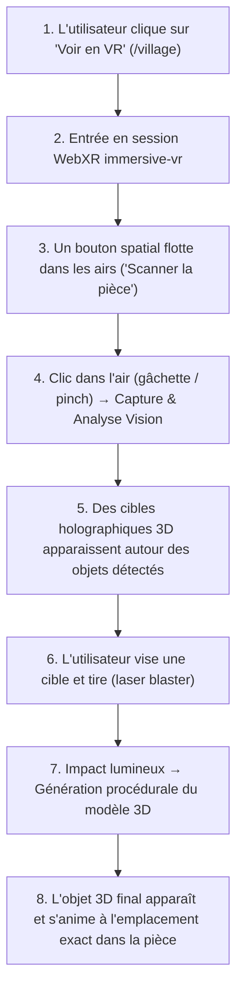

# Immersion WebXR sur /village : Détection Spatiale dans les Airs & Tir/Génération 3D

> **Statut :** Analyse de faisabilité & Spécification technique  
> **Cible :** Route `/village` (Village Studio / Vision Insert)  
> **Technologies :** WebXR, Three.js, React Three Fiber (R3F), Meta IWER (Émulateur Quest 3), Meta Muse Spark + SAM  
> **Environnement de test :** Émulateur desktop (100 % sans casque) et casque physique Meta Quest (Quest 3 / 3S / Pro)

---

## 1. Résumé exécutif

| Question                                  | Statut          | Détails                                                                                                                                                                                                              |
| ----------------------------------------- | --------------- | -------------------------------------------------------------------------------------------------------------------------------------------------------------------------------------------------------------------- |
| **Est-ce techniquement possible ?**       | **OUI**         | L'ensemble du cycle (bouton 3D dans l'espace, capture, détection IA, raycast de tir laser, apparition procédurale 3D) s'appuie sur des technologies WebXR standardisées et des modules déjà présents dans le projet. |
| **Faisable avec l'émulateur seulement ?** | **OUI à 100 %** | Grâce au preset Meta Quest 3 de **Meta IWER 2.8.0** déjà intégré dans le projet (`dev-xr-emulator.ts`), le déplacement, la visée laser et la gâchette se testent au clavier/souris sans casque physique.             |
| **Mode hors-ligne / développement**       | **Garanti**     | Compatible avec `make dev-mock` : les détections et shapes 3D s'exécutent en local sans clé API externe requise.                                                                                                     |

---

## 2. Parcours utilisateur & Cycle d'interaction



---

## 3. Décomposition technique des 4 phases

### Phase 1 : Bouton spatial "dans les airs" (Diegetic Spatial UI)

- **Défi WebXR :** Les balises HTML standards du DOM (`<button>`, `<div>`, `<Html>` de Drei) ne sont pas projetées en stéréo dans le casque VR.
- **Architecture retenue :**
  - Un composant 3D Three.js pur (`<SpatialAirButton />`) suspendu dans le champ de vision (coordonnées relatives tête : `[0, 1.4, -1.2]` m).
  - Plaque holographique translucide en verre sombre, bordure cyan brillante (`TOKEN_HEX.energyCyan`), pulsation lumineuse d'attente.
  - Interaction : survol par le pointeur laser du contrôleur XR, puis appui sur la gâchette (`selectstart`).

### Phase 2 : Détection en temps réel sans upload classique

- **Mécanismes de capture :**
  1. **En émulateur (Desktop sans casque) :**
     - Capture instantanée du framebuffer WebGL (`renderer.domElement.toDataURL('image/jpeg')`) OU capture du flux webcam de l'ordinateur via `navigator.mediaDevices.getUserMedia({ video: true })` OU utilisation de la scène diorama / pièce témoin (`public/samples/vision-room.jpg`).
  2. **Sur casque réel (Meta Quest Browser) :**
     - **Mode VR (`immersive-vr`) :** La pièce virtuelle (atelier, clinique, salle commune) est capturée directement depuis la caméra de l'observateur.
     - **Note sur l'AR Passthrough (`immersive-ar`) :** Quest Browser n'accorde pas l'accès direct aux pixels bruts des caméras passthrough externes pour des raisons de confidentialité (_privacy sandboxing_). Le mode VR complet avec environnement 3D ou webcam locale contourne totalement cette limitation.
- **Traitement & Réticules spatiaux :**
  - L'image capturée est envoyée à `POST /api/vision`.
  - La réponse fournit `ApplianceDetection[]` (boîtes 2D normalisées `[ymin, xmin, ymax, xmax]`, labels, catégories).
  - Le système projette ces coordonnées 2D dans l'espace 3D à une distance focale estimée (ex: $z = -2.0\text{ m}$), créant des composants `<HoloDetectionTarget />` :
    - Cadre filaire cyan animé.
    - Étiquette textuelle 3D flottante (ex: _"Réfrigérateur · 180W"_ ou _"Panneau Solaire"_).
    - Sphère d'impact invisible servant de _collider_ pour le Raycaster.

### Phase 3 : Visée & Tir sur l'objet ("Laser Blaster")

- **Mécanique de visée :**
  - Le contrôleur WebXR actif (`renderer.xr.getController(0)`) projette un rayon laser semi-transparent (`Line` ou cylindre émissif).
  - À chaque frame de la boucle de rendu XR (`useFrame`), un `THREE.Raycaster` vérifie les collisions avec les cibles `<HoloDetectionTarget />`.
  - Au survol : la cible passe du cyan à l'ambre (`solarAmber`), signalant qu'elle est verrouillée.
- **Action de tir :**
  - À l'appui sur la gâchette (_trigger pull_ / clic gauche dans l'émulateur) :
    - Émission d'un trait laser rapide du contrôleur vers le centre de la cible.
    - Animation d'impact : flash blanc, onde de choc sphérique cyan, particules de déflagration.
    - Déclenchement de la vibration haptique sur le contrôleur (`gamepad.hapticActuators[0].pulse()`).

### Phase 4 : Génération et apparition du modèle 3D in-situ

- **Appel de génération :**
  - La cible touchée déclenche la requête vers `POST /api/vision/shape` (ou génère la recette via les utilitaires locaux `recipeMesh` / `silhouetteMesh` de `apps/web/src/features/vision-insert/utils/object-geometry.ts`).
- **Séquence d'apparition animée (Spawn Sequence) :**
  1. **Phase 1 (0.0s – 0.3s) :** La cible holographique implose sous l'impact.
  2. **Phase 2 (0.3s – 0.8s) :** Les arêtes du modèle 3D se dessinent sous forme de lignes d'encre verte/cyan (_ink wireframe_).
  3. **Phase 3 (0.8s – 1.4s) :** Les volumes s'extrudent progressivement (effet d'échelle de 0 à 1 avec amorti élastique).
  4. **Phase 4 (1.4s+) :** Les textures et matériaux PBR finaux s'appliquent. L'objet 3D devient physique, projetant des ombres au sol (`ContactShadows`).
  5. L'objet peut ensuite être inspecté, déplacé ou raccordé directement au réseau microgrid du village.

---

## 4. Fonctionnement sous Émulateur (Mode Desktop Développeur)

### Comment tester sans aucun casque physique :

1. **Lancer le serveur en mode mock :**
   ```bash
   make dev-mock
   ```
2. **Accéder à `/village` :**
   - Le script `installDevXREmulator()` s'exécute automatiquement en environnement `development` dès qu'aucun casque n'est branché.
   - Le bouton VR (« Voir en VR » avec l'icône lunettes) devient actif.
3. **Dans la session émulée :**
   - L'overlay **Meta IWER DevUI** s'affiche en surimpression sur l'écran.
   - Cliquez sur **Play Mode** dans la barre DevUI :
     - **Souris :** Oriente le regard et le pointeur du contrôleur droit.
     - **Touches ZQSD / WASD :** Déplace la position de la caméra dans l'espace.
     - **Clic gauche de souris :** Simule l'appui gâchette (_Trigger / Select_), permettant de cliquer sur le bouton dans les airs puis de tirer sur les cibles.

---

## 5. Architecture des fichiers & Modules à créer / réutiliser

### Modules existants à réutiliser directement :

- `apps/web/src/features/microgrid-3d/hooks/use-webxr.ts` : cycle de vie session XR (`status`, `enter`, `exit`).
- `apps/web/src/features/microgrid-3d/utils/dev-xr-emulator.ts` : runtime IWER preset Quest 3.
- `apps/web/src/features/vision-insert/utils/object-geometry.ts` : `recipeMesh`, `silhouetteMesh` (génération procédurale des modèles 3D).
- `apps/web/src/features/vision-insert/hooks/use-vision-session.ts` : orchestration des détections d'appareils.
- `apps/web/src/server/perception/mock.ts` : détections hors-ligne garanties.

### Nouveaux composants recommandés (dans `apps/web/src/features/vision-insert/ui/xr/`) :

| Composant / Fichier         | Responsabilité                                                                                |
| --------------------------- | --------------------------------------------------------------------------------------------- |
| `village-xr-canvas.tsx`     | Conteneur R3F configuré avec `renderer.xr.enabled = true`, frameloop adaptatif et rig caméra. |
| `spatial-air-button.tsx`    | Bouton 3D flottant avec shaders de survol, réactif aux contrôleurs XR.                        |
| `xr-blaster-controller.tsx` | Gestion du pointeur laser, raycasting continu et événement de tir à la gâchette.              |
| `holo-detection-target.tsx` | Cible holographique 3D représentant une détection de meuble/appareil.                         |
| `spawned-object-3d.tsx`     | Rendu de l'objet généré avec son animation de matérialisation in-situ.                        |

---

## 6. Vérifications et critères de succès

- [ ] `make dev-mock` permet d'entrer en VR sur `/village` via l'émulateur IWER sans erreur console.
- [ ] Le bouton 3D « Scanner la pièce » flotte dans le champ de vision et réagit au survol du curseur.
- [ ] Le clic déclenche la détection et fait apparaître au moins 2 cibles holographiques 3D dans l'espace.
- [ ] Pointer une cible et tirer déclenche le faisceau laser et un effet d'impact.
- [ ] Le modèle 3D procédural s'anime et se stabilise à l'emplacement exact de la cible.
- [ ] `make check` reste 100 % vert (typecheck, lint, tests Vitest, i18n EN/FR/MG).
